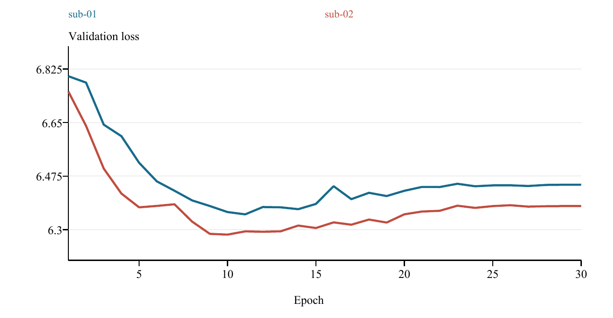
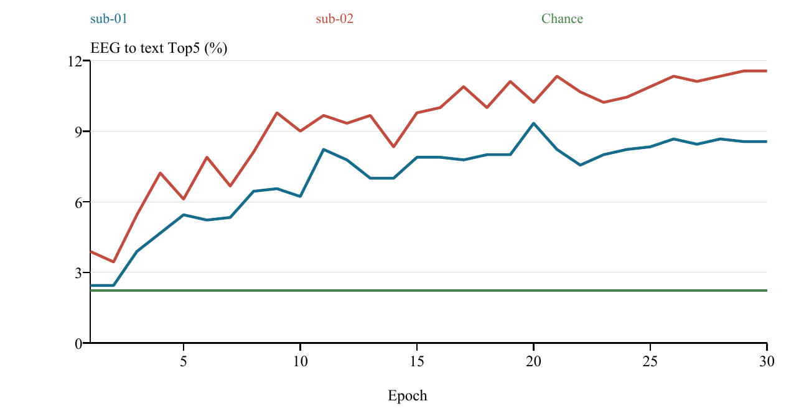
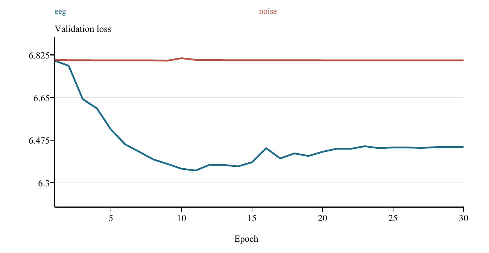
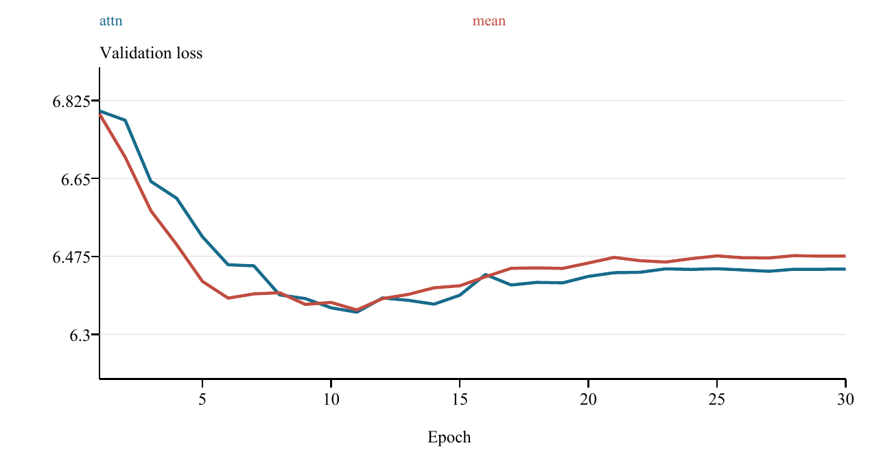
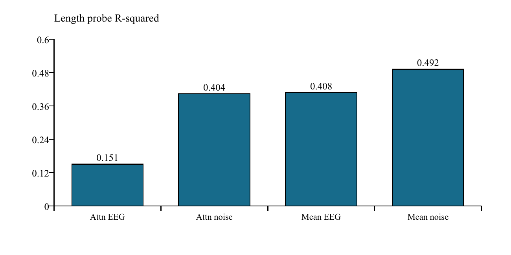
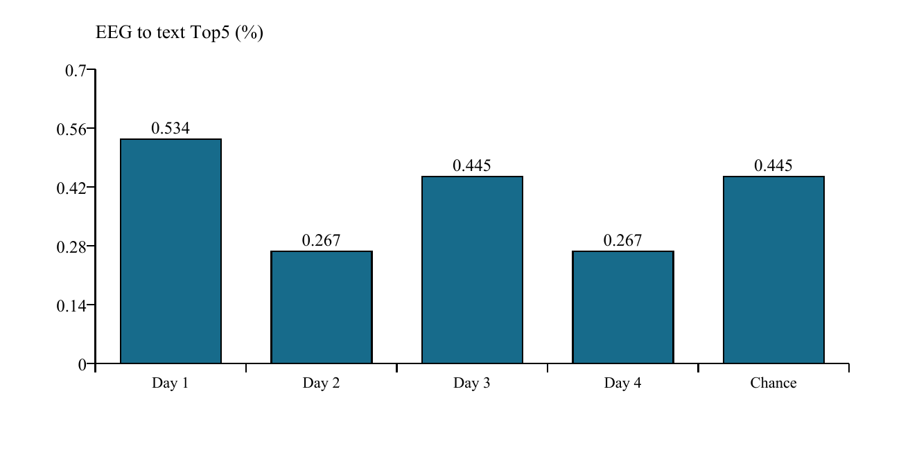
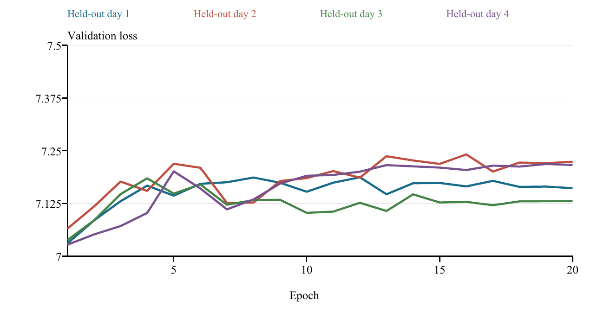

# 摘要

非侵入式脑电与自然语言之间的表征对齐，是面向语言交互的脑机接口研究中的重要问题。与固定类别识别相比，句子级脑电解码同时面临信号噪声较强、试次长度不同、同句重复记录相关以及跨采集会话分布变化等困难。仅在单一数据划分上取得高于随机的结果，尚不足以说明模型获得了稳定的语言相关表征。本文以 Chisco-2.0 数据集为对象，研究字符时长引导的脑电分段编码、脑电与中文句向量的多正样本对比学习，以及模型在不同评估条件下的泛化边界。

本文根据实验中每字符 0.4 s 的时长规则，将变长脑电切分为等长局部片段，采用共享时空卷积编码器提取片段特征，并通过位置编码、Transformer 和注意力池化获得句子级脑电表示。文本侧使用冻结的 LaBSE 编码器，两种模态在归一化向量空间中进行对齐。针对同一句子重复录制所形成的多个脑电试次，设计按句子分组的批次采样，并采用多正样本对称对比损失，避免将同句样本错误视为负样本。实验设置涵盖同被试未见句子检索、随机噪声对照、池化方式比较、长度线性探针、跨天留一评估和跨被试零样本评估。

在两名被试的 day 1 至 day 4 数据上，按句子划分得到 899 个训练句子与 225 个验证句子，每名被试分别包含 3596 条训练试次和 900 条验证试次。按最小验证损失选择模型时，脑电到文本 Top-5 命中率分别为 8.22% 和 9.00%，高于 225 个候选句下的 2.22% 随机期望。真实脑电与高斯噪声对照中，脑电到文本 Top-5 分别为 8.22% 和 2.33%。池化比较表明，注意力池化和掩码平均池化的最小验证损失接近，而长度探针在真实脑电输入上的决定系数分别为 0.151 和 0.408，说明注意力池化对应表示中可线性读出的长度信息较少，但长度信息并未被完全消除。

跨天留一实验中，四折脑电到文本 Top-5 的均值为 0.378%，样本标准差为 0.133 个百分点，接近 1124 个候选句对应的 0.445% 随机期望；四折最佳验证损失均出现在第 1 轮。跨被试两个方向的脑电到文本 Top-5 约为 0.58% 和 0.47%，同样未呈现稳定的迁移优势。结果表明，当前方法在同被试、同一组采集天内能够获得一定的候选句检索能力，但这种能力尚不能稳定迁移至新采集天或新被试。噪声对照支持真实输入中存在可被模型利用的结构，却不足以排除长度、时间顺序和残余伪迹等混杂因素。

本文形成了从预处理、变长建模到多层次评估的完整实验流程，并明确了当前方案的有效范围及局限。由于现有实验采用单随机种子，并使用验证集选择和报告模型，所得数值属于探索性验证结果。未来应通过独立测试集、多种子重复、保留频谱结构的对照及会话层面的域适应，进一步检验脑电语言表征的稳定性。

关键词：脑电信号；中文文本检索；字符级分段；对比学习；跨天泛化；长度探针

# Abstract

Aligning non-invasive electroencephalography with natural language is an important problem in language-oriented brain-computer interfaces. Sentence-level EEG decoding is challenged by noisy measurements, variable trial duration, repeated recordings of identical sentences, and distribution shifts across recording sessions. Above-chance performance under a single data split does not establish that a model has learned stable language-related representations. This thesis studies character-duration-guided EEG tokenization, multi-positive contrastive alignment with Chinese sentence embeddings, and the generalization boundaries of the resulting retrieval model using Chisco-2.0.

Variable-length EEG trials are divided into fixed-duration tokens according to the 0.4-second character timing used in the experimental protocol. A shared temporal-spatial convolutional encoder extracts token features. Learnable positional embeddings, a Transformer encoder, and attention pooling produce a normalized sentence-level EEG embedding. A frozen LaBSE encoder provides text embeddings. Sentence-grouped sampling and a symmetric multi-positive contrastive objective accommodate repeated EEG recordings of the same sentence. Evaluation includes unseen-sentence retrieval within each participant, an independent Gaussian-noise control, a pooling comparison, a linear length probe, leave-one-day-out validation, and cross-participant transfer.

For each of two participants, the sentence-disjoint split contains 899 training sentences and 225 validation sentences, corresponding to 3,596 and 900 trials. At the checkpoints selected by minimum validation loss, EEG-to-text Top-5 accuracy reaches 8.22% and 9.00%, compared with a chance expectation of 2.22%. In the signal-versus-noise experiment, the corresponding values are 8.22% and 2.33%. Attention and masked mean pooling obtain similar minimum validation losses. Their length probes yield R-squared values of approximately 0.151 and 0.408 on real EEG, respectively, indicating reduced but persistent linearly accessible length information with attention pooling.

In leave-one-day-out evaluation, mean EEG-to-text Top-5 accuracy is 0.378%, with a sample standard deviation of 0.133 percentage points, against a chance expectation of 0.445%. All four folds select the first epoch. Cross-participant Top-5 accuracies are approximately 0.58% and 0.47%, providing no clear evidence of reliable transfer. The results support limited retrieval ability within participants and observed recording days, while revealing substantial session and participant dependence. Noise controls indicate that real inputs contain useful structure, but do not establish a uniquely neural-semantic origin or rule out all confounds.

The thesis provides an integrated experimental pipeline and a bounded interpretation of its results. Single-seed training and validation-based checkpoint selection limit inferential strength. Independent testing, repeated runs, structured controls, and session-aware adaptation are required to assess more robust EEG-language alignment.

Keywords: electroencephalography; Chinese text retrieval; character-level tokenization; contrastive learning; cross-session generalization; length probing

{{TOC}}

# 缩略语与符号说明

表 0-1 主要缩略语

| 缩略语 | 英文全称或含义 | 中文说明 |
| --- | --- | --- |
| EEG | Electroencephalography | 脑电记录 |
| BCI | Brain Computer Interface | 脑机接口 |
| CNN | Convolutional Neural Network | 卷积神经网络 |
| ICA | Independent Component Analysis | 独立成分分析 |
| EOG | Electrooculography | 眼电记录 |
| LaBSE | Language agnostic BERT Sentence Embedding | 多语言句向量编码器 |
| GN | Group Normalization | 分组归一化 |
| E→T | EEG to Text | 脑电到文本检索 |
| T→E | Text to EEG | 文本到脑电检索 |
| Top-k | Hit within the first k candidates | 前 k 个候选中命中 |
| R² | Coefficient of determination | 决定系数 |

本文以 C 表示脑电通道数，T 表示单 token 的采样点数，n 表示一个试次的有效 token 数，B 表示批次中的试次数，d 表示 Transformer 隐藏维度，D 表示共享表征空间维度，τ 表示对比学习温度。e 和 t 分别表示归一化后的脑电向量与文本向量，M 表示有效 token 掩码。除另有说明外，检索率以百分数表示，损失和 R² 不具有百分数单位。

# 第一章 绪论

## 1.1 研究背景

脑机接口尝试建立神经活动与外部信息系统之间的联系。语言相关脑机接口所面对的目标尤其复杂：系统既需要从测量信号中识别与语言活动有关的变化，又需要将这些变化映射为具有明确含义的符号或文本。头皮脑电具有非侵入式采集的特点，可以用于研究语言加工过程中的时间变化，但观测值也混合了不同脑源、眼动、肌肉活动和测量环境的影响。因而，脑电与句子标签之间存在统计关联，并不自动意味着系统已经识别出可独立解释的语义过程。

随着神经网络和预训练语言表示的发展，脑电语言研究逐步从有限类别分类延伸到句子表示匹配和文本生成。自然阅读语料 ZuCo 为阅读条件下的脑电与语言研究提供了数据基础[1]，Chisco 则面向中文想象言语提供句子级数据[2]。后续 COFETT 工作进一步关注重复采集与脑电不稳定性，将评估条件本身纳入研究问题[3]。这些工作说明，数据范式、记录条件和测试协议需要与模型结构一起分析，不能仅以单一指标概括解码能力。

本研究采用 Chisco-2.0 的本地实验工程开展句子级检索研究。工程中的 inner 事件表示按实验提示执行的内语阶段，具有已知的句子标签和预设时长。本文沿用事件命名，但不把这一受控任务等同于无提示、自由发生的内部语言活动。实际系统能够访问的是脑电片段及其边界，训练和评估所依赖的边界来自数据集的事件信息与时长规则。这样的研究范围有利于准确界定任务，而不会把离线匹配能力扩展解释为实时读取任意思想。

对于当前工程，最直接的问题是：在保持原始句子长度差异的条件下，能否用一个共享编码器提取可用于文本检索的脑电表征；这种表征在同被试数据上出现的优势能否经受噪声替换、结构对照和采集域变化的检验。本文围绕这两个问题展开，并把不成功的迁移结果作为论证的重要组成部分。

## 1.2 问题提出与研究意义

句子级 EEG 的持续时间通常不是常量。若对每条记录直接补零到全局最大长度，会产生大量无效位置，并可能改变卷积归一化的统计量。若把所有记录拉伸或压缩到同一时间长度，则可能改变原本的局部时间尺度。当前数据集具有每字符固定时长的范式规则，因此可将变长问题从单段采样点数转移为固定窗口的数量。这样的分段能够复用局部特征提取器，并用序列模型处理数量不同的片段。

然而，固定时长分段也引入了新的解释问题。片段数量与句长紧密相关，掩码和位置编码可能使模型获得句长线索。即使分类或检索指标提高，也需要检验这种提高是否依赖真实信号内容。另一方面，同一句子在不同天重复录制，为多正样本训练提供了条件，但也使简单的试次随机划分容易混合相同标签的记录。评价协议必须明确：究竟是在识别已见句子的另一次记录，还是在检索训练中从未出现的句子。

本文的意义主要体现在三个方面。其一，建立与实验时长规则一致的变长 EEG 编码流程，使每个处理阶段及张量形状可被检查。其二，通过句子分组和多正样本损失，明确同句重复记录在训练中的角色，减少由错误负样本定义带来的冲突。其三，通过多种对照揭示模型使用信息的可能来源和适用边界，为后续实验优先级提供依据。

本研究的价值不以取得最高检索率为前提。若一种结构仅在同一组采集天内有效，却不能跨天泛化，那么这一事实本身就限定了它的应用条件。对失败条件的识别，能够帮助区分应优先改进局部编码、跨会话对齐还是评估设计，也能够避免在未经检验的前提下继续增加模型复杂度。

## 1.3 研究问题

本文首先研究字符时长引导的局部编码与句子级语义空间对齐是否能够在同被试未见句子上得到高于随机期望的检索结果。这里的未见句子指句子字符串未参与训练；验证信号仍来自与训练相同的一组采集天，因此该问题主要考察同一采集域内的标签外推。

第二个问题是输入内容与结构信息各自可能发挥什么作用。本文分别采用保留形状的独立噪声替换、注意力池化与掩码平均池化比较，以及从句子向量预测 token 数的线性探针。三个实验回答的是不同层面的问题：输入分布改变后检索是否保留、池化方式是否改变性能、表示中是否存在可读出的句长信息。它们共同提供证据，但不能相互替代。

第三个问题是这种对齐能否迁移到新采集天或新被试。跨天实验保持句子集合重复而改变会话，跨被试实验改变信号来源个体。若模型在这两种条件下接近随机期望，则需要把同域结果解释为条件受限的匹配能力，而不能据此宣称获得了通用的脑电语言表示。

## 1.4 研究内容与技术路线

研究首先从原始 EDF 和事件表建立一致的信号与文本索引，通过通道处理、重采样、鲁棒重参考、坏通道修复及 ICA 处理形成 FIF 文件。随后汇总每个试次的被试、天、run、句子、起始点和持续点数，作为数据集读取的统一入口。该过程将信号处理与模型训练分开，便于重复使用相同输入开展对照。

模型层面，局部 EEG token 经时间卷积与跨通道空间卷积映射为固定维度特征，序列层利用 Transformer 建模片段间关系，池化层产生定长脑电向量。文本侧保持 LaBSE 参数冻结，预先缓存唯一句子的表示。训练时只更新脑电编码器，通过对称对比目标建立共同空间中的匹配关系。

评估层面，本文从同域检索逐步扩展到输入替换、结构比较、表征探针和域外测试。所有主要表格按照相应运行目录中的验证损失选择同一个轮次，再报告该轮的所有检索指标，避免把不同轮次的峰值拼接为一行结果。训练曲线用于分析优化过程，不承担独立测试的角色。

## 1.5 本文工作与贡献边界

本文完成了一个面向当前中文内语数据的字符时长 EEG 编码和句向量对齐实现，并将重复试次纳入多正样本训练。工作中的卷积、Transformer、句向量和对比学习均建立在已有方法之上，因此贡献定位为任务适配、工程整合与实验分析，而不是提出全新的基础网络或损失函数。

在实验方面，本文建立了相互补充的诊断序列，观察到同被试同采集域内高于随机的检索、真实输入与噪声输入的差异，以及长度可读性与检索表现之间的不一致。同时，跨天和跨被试实验没有提供稳定迁移的证据。这些发现支持对当前模型作有边界的评价，也暴露了后续研究必须处理的分布变化问题。

本文不将注意力池化定义为已被证明的抗泄漏机制。长度探针表明其输出仍保留一定长度信息；单次池化消融也不足以证明统计意义上的优越性。论文同样不把噪声对照的差异解释为已排除全部非神经混杂。这样的边界使方法说明与实验结论保持一致。

## 1.6 论文结构

第一章介绍研究背景、问题、内容与贡献范围。第二章讨论相关研究和所需理论。第三章介绍数据组织、预处理和切分协议。第四章说明字符时长引导的脑电编码器、文本编码、多正样本采样与损失。第五章报告实验设置、主要结果和诊断分析。第六章讨论结果解释、有效性限制与后续方案。第七章总结研究结论与展望。附录给出复现命令、实验来源、评估公式和结果解释准则。

# 第二章 相关研究与理论基础

## 2.1 脑电语言任务与数据范式

语言相关脑电研究包含不同任务。自然阅读记录视觉输入、眼动和理解过程共同作用下的神经活动；内语或想象言语任务要求被试在提示后进行内部复述；外显发声任务还包含运动及听觉反馈。三者在行为、时序和伪迹来源上存在差异。数据来自哪一种范式，决定了模型可能接触哪些统计线索，也决定了结果能够推广到哪些使用场景。

ZuCo 将自然阅读中的 EEG 与眼动共同记录，为多模态语言加工研究提供了资源[1]。Chisco 面向中文想象言语记录，扩展了中文句子级研究材料[2]。本文使用的 Chisco-2.0 与 COFETT 相关，其研究设计强调重复采集及 EEG 的不稳定性[3]。本文依赖本地数据说明和实际元数据报告样本规模，不将其他版本的被试数量、固定试次时长或语料数量直接移植到当前实验。

从数据范式角度看，重复句子是一种双重资源。它允许把同一标签的多次记录作为正样本，从而尝试压缩记录条件造成的变化；同时，它也使标签、记录天和呈现顺序之间形成复杂关系。如果同一语料按相似顺序呈现，那么脑电中的慢变背景、疲劳趋势或 run 特征可能与句子身份相关。仅以句子标签训练的网络不会主动区分这些来源，需要通过额外划分和对照检验。

## 2.2 文本生成与候选检索

EEG 到文本可以构造成序列生成任务，也可以构造成候选检索任务。前者要求模型逐步输出字符或词，通常依赖语言解码器；后者要求在预先给定的候选句表示中选择与脑电最匹配的一项。两者使用的评价指标、输出空间和先验条件不同，不能仅因输入与输出都涉及脑电和文本便视为同一任务。

Wang 和 Ji 将自然阅读 EEG 与预训练语言模型结合，探索开放词表解码和情感分类[4]。后续研究指出，teacher forcing 与噪声基线会显著影响 EEG 文本系统的评价，强调需要判断输出究竟依赖神经输入还是语言先验[5]。本文选择候选检索，不使用自回归文本生成，也不报告 BLEU、ROUGE 或字错误率。该选择减少了生成阶段的解释负担，但仍需处理候选集合、句长和重复标签带来的偏差。

检索并不等同于没有文本先验。LaBSE 已在大规模语言任务上训练，候选句空间本身也包含语言结构。本文冻结文本编码器，并让脑电编码器学习映射到该空间。测试时虽不向脑电网络输入正确句子的内容，但系统需要事先知道候选句及其向量。因此，本文结果应解释为受约束候选空间内的匹配能力，而不是任意中文文本的自由恢复。

## 2.3 EEG 的卷积特征提取

EEG 的通道和时间轴具有不同含义。时间卷积可以提取局部波形变化，跨通道卷积可以学习电极之间的组合。EEGNet 等紧凑卷积研究表明，针对 EEG 结构设计的网络能够以较少参数开展脑机接口分类[6]。NICE 则将 EEG 表征与视觉表示进行对比对齐，为时空卷积与跨模态匹配的结合提供了参考[7]。本文借鉴这一类设计思想，但当前实现并非这些模型的完整复现，也不与原论文数值直接比较。

在本文中，每个 token 只有 100 个采样点，因此局部编码器需要保持足够的时间分辨率。时间卷积和池化后仍保留 40 个时间位置，再利用空间卷积压缩通道维。所有位置共享编码权重，使同一局部结构可以在不同字符时长窗口中被相同方式处理。相较于为每个位置设置独立网络，共享编码在参数规模和变长适应方面更易控制。

时空卷积的可训练权重可以提高匹配能力，但其权重不应直接被解释为脑源定位结果。头皮信号的空间混合、重参考以及坏通道插值都会改变通道间关系。若希望对特定脑区作解释，还需要专门的空间扰动、稳定性分析和神经生理验证。本文把卷积层视为统计特征提取器。

## 2.4 Transformer 与序列聚合

Transformer 以注意力机制建模序列元素间关系[8]。对当前任务而言，输入序列是按时间排列的 EEG 片段特征，而不是文字 token。自注意力可以让一个片段的表示综合其他有效片段的信息，但不会自动赋予该片段明确的字符语义。位置编码用于保留顺序信息，掩码用于限制无效填充位置参与聚合。

由变长序列获得定长向量可采用平均池化或注意力池化。掩码平均池化只对有效位置求均值，结构简单且没有额外的聚合参数。注意力池化用可学习查询对各位置加权，允许不同片段对最终表示贡献不同。二者的差异并不能预先推导出性能高低，必须结合数据量、训练稳定性和实际消融结果判断。

注意力权重也不天然等同于解释。某个时间窗权重较高，只表明在当前模型计算中具有较大聚合系数，未必说明它对应的语言单位被成功识别。尤其当位置编码或长度与标签相关时，注意力可能使用结构信号。因此本文把注意力池化视为可训练的序列压缩算子，并专门检验长度信息是否保留。

## 2.5 句向量与跨模态对齐

句向量方法将自然语言句子映射到定长向量，使语义匹配能够通过距离或相似度进行。Sentence-BERT 提供了以孪生网络构造句子表示的思路[9]，LaBSE 则面向多语言句子嵌入[10]。本文采用冻结 LaBSE 作为中文句子标签的向量化工具，选择它的目的在于获得固定的比较空间，而不在本工程内重新训练语言侧模型。

冻结文本编码器具有明确的实验含义。首先，训练中所有参数更新来自 EEG 分支，减少了两个模态同时变化造成的解释困难。其次，唯一句子的文本向量可以在训练前计算并缓存，避免重复编码。再次，验证句子也可以在同一固定空间中表示，使“未见句子”评估不必依赖一个只含训练类别的分类输出层。

但文本编码器仍会引入表示偏好。句子相似度可能同时受词汇重叠、句式和长度影响，未必只反映任务关心的语义关系。对齐至这样的空间意味着 EEG 网络可能同时学习多种可预测因素。本文因此将输出称为“与文本空间对齐的脑电表示”，而不直接称为已分离的纯语义表示。

## 2.6 对比学习与多正样本目标

对比学习通过提高匹配样本相似度、降低不匹配样本相似度来学习表示。InfoNCE 类目标在表示学习中得到广泛使用[11]，CLIP 将对称图文匹配用于跨模态表征训练[12]。本文采用类似的双向匹配结构，将图像分支替换为 EEG 编码器，并使用句子标签确定正样本关系。

标准的一一匹配目标通常把相似度矩阵的对角元素视为正确配对。然而在同句重复录制中，多条 EEG 对应相同的句子向量。若仍将非对角元素全部视为负例，会把合法匹配错误排斥。多正样本思想允许同一组标签对应多个正例，与监督式对比学习的分组观念相关[13]。本文具体采用所有正例对数概率的平均，再对两个检索方向取平均。

该目标必须与采样机制配合。如果随机抽取一个很小的批次，同一句子的多个记录可能很少同时出现，多正样本定义就难以在优化中发挥作用。按句子先分组、再抽取多条记录，可以显式控制每个锚点的正例数量。值得注意的是，按句子分组并不自动保证每组记录来自不同天，只有数据中每句每天一条且抽取数量覆盖各天时才具备这一性质。

## 2.7 归一化与优化

批次归一化利用同一批次中的统计量。当局部 token 被展开为批次维后，补零 token 也可能进入这些统计量。Group Normalization 的统计范围不依赖其他批次样本[14]，因而本文采用单组 GN 对每个 token 独立归一化，使真实 token 的归一化不受同批填充数量直接影响。这里的设计动机来自计算结构，性能收益仍需要专门消融。

优化器使用 AdamW，其核心思想是将权重衰减与自适应梯度更新分开处理[15]。学习率在预设训练轮数内进行余弦衰减。该设置能够减少后期更新幅度，但不保证验证损失单调下降，也不能代替独立验证。本文通过保存验证损失最小的模型控制模型选择，同时报告这一选择机制本身带来的评估限制。

## 2.8 评估可信性与本文定位

已有 EEG 文本研究提示，严格评价应考虑输入替换、采样相关性和训练测试差异[3,5]。本文据此采用逐层收紧条件的分析方式：同域未见句子评估回答局部可用性，噪声对照回答输入内容是否重要，长度探针回答表示是否包含结构信息，跨天与跨被试评估回答采集域外的稳定性。

上述问题的逻辑关系需要明确。噪声条件下接近随机不能证明真实 EEG 中的全部优势都来自语义神经信号；探针能够读取长度也不证明模型在检索时必然依赖长度；跨天失败也不能证明 EEG 不含语言信息。本文的结论始终针对当前数据、网络、优化和评估协议的组合，而不把单一实验扩大为对整个研究方向的判断。

# 第三章 数据集与预处理方法

## 3.1 数据来源与使用范围

本文使用公开数据集 Chisco-2.0 的本地副本，数据标识为 OpenNeuro ds006317，元数据记录的版本为 1.1.1，DOI 为 10.18112/openneuro.ds006317.v1.1.1。数据包含 sub-01 和 sub-02 两名被试，原始记录采用 EDF 格式，并以 BIDS 目录组织。其公开研究背景与 COFETT 工作相关[3]。本文开展的是已有公开数据的二次分析，不新增被试招募或数据采集。

本地工程将每个被试的记录映射为 day 1 至 day 8。其中 day 1 至 day 4 对应四个 session 的 para1，day 5 至 day 8 对应相同四个 session 的 para2。这里的 day 是工程映射编号；day 1 与 day 5 对应相同 session 的不同任务，不能仅因编号不同就认为它们必然来自不同物理采集日。因此跨天分析采用同一 para 内的 day 1 至 day 4，以保持会话划分的解释一致。

主实验、噪声对照、池化比较和跨被试评估均使用 day 1 至 day 4 的 inner 事件。para2 用于说明数据组织及重复结构，本文不将其直接加入主结果，也不将没有对应日志的配置视为已经完成的实验。由 250 Hz 汇总表重新统计得到的数据规模见表 3-1。

表 3-1 本地预处理元数据规模

{{TABLE:data}}

## 3.2 试次事件与文本对齐

原始事件表提供事件 onset、采样点和编码。工程将读取开始、内语开始、短休息与长休息映射为可读注释，文本表则依据任务和 run 选择相应的句子列表。para1 的不同 run 对应不同文本文件，para2 的各 run 使用同一文本表。每条句子与相同位置的 reading 和 inner 事件配对。

在写入文本 sidecar 前，程序检查 reading 事件数、inner 事件数和句子数是否一致。该检查能够发现数量失配，但不能独立证明每个索引处的句子与事件内容完全正确。如果记录中存在相同数量的事件错序，仅比较长度无法发现，因此事件顺序核验仍是后续质量控制的重要补充。本文依赖数据集提供的顺序及当前工程的配对规则。

非标点字符数通过 Unicode 标点类别计算。该定义与中文字符数量接近，但空格、数字和英文字母等非标点字符也会计入，因此严格说它是“非标点字符计数”，而不必然等于语言学意义上的汉字数。对当前文本内容，持续时间依此计数构造。本文在公式中使用 n_char 表示这一工程计数。

## 3.3 通道处理与空间信息

工程使用 montage 文件为 EEG 电极建立坐标对应，将 VEO 和 HEO 标记为眼电通道，并剔除坐标无效的通道 10 和 111。模型使用预处理后类型为 EEG 的通道，默认网络构造对应 122 个通道。空间坐标缺失时预处理采用报错方式，而不是静默忽略，以减少通道定义不一致。

对跨文件和跨被试建模而言，通道数量一致只是必要条件。空间卷积的权重与通道顺序绑定，因此还应保证电极名称和顺序一致。当前跨被试预测入口检查通道数和 token 长度，但没有形成完整的逐通道顺序审计报告。本文将这一点列为复现与迁移验证时需要强化的检查，避免把未经检查的输入排列差异全部解释为个体神经差异。

## 3.4 重采样与坏段标注

预处理默认将信号重采样至 250 Hz。原始事件首先按秒数写入注释，之后对信号重采样，使注释的时间单位与采样率变化相分离。汇总脚本再依据目标采样率把 onset 转换为整数采样点，使用四舍五入进行离散化。数据读取时检查目标采样率与文件实际采样率一致，并检查切片范围，避免错误配置造成无声偏移。

工程将任务前导段、长休息段和尾部非任务段标记为 BAD 注释，以便后续固定长度 epoch 构造时排除这些片段。长休息的范围从对应开始事件延续到下一次 reading 开始，尾部从最后一次短休息开始延续至记录末尾。该逻辑针对当前范式组织，不应不加修改地应用于其他事件协议。

BAD 注释主要参与预处理估计过程。训练数据集直接按 trial 起点和理论持续点数读取 FIF，并没有再次依据所有 BAD 注释拒绝试次。因此，不能把预处理中的坏段排除表述为对最终训练样本执行了完整的逐试次自动剔除。论文对每一阶段的作用进行区分，以免高估质量控制的覆盖范围。

## 3.5 鲁棒参考与伪迹处理

预处理首先使用 PyPREP 执行线噪处理、鲁棒重参考和坏通道相关处理。PREP 方法为标准化 EEG 预处理提供了参考[16]。当前配置的线噪频率为低于奈奎斯特频率的 50 Hz 倍频，RANSAC 选项关闭。程序记录原始坏通道、已插值通道和仍有问题的通道，便于保留质量控制信息。

随后，工程显式对 EEG 执行 1 Hz 高通滤波。该步骤的目的在于削弱低频漂移，并为之后的 ICA 拟合提供较稳定输入。本文不将其写成未经实现的完整 1 至 45 Hz 带通；1 至 45 Hz 只出现在后续频谱一致性分析的频率范围中。信号处理的实际参数应以代码执行阶段为单位报告。

ICA 拟合前，程序将连续数据构造成 2 s 的固定长度 epoch，利用 Autoreject 的阈值估计功能确定拒绝门限并剔除不合格 epoch[17]。这些 epoch 用于拟合 ICA；最终保存的仍是连续信号。当前实现没有对全部任务 trial 运行完整的局部 Autoreject 修复，因此不能将这一流程与完整的 trial 级自动修复算法混为一谈。

ICA 使用 30 个成分、固定随机状态和扩展 Infomax。拟合后利用 ICLabel 给成分赋予类别，保留 brain 和 other 类，其余类别被排除，再将 ICA 处理应用回连续信号[18]。对仍被标记为坏通道的电极，在 ICA 后继续插值。该策略能够减少部分伪迹，但自动分类存在误差，保留 other 类也意味着未确定成分继续存在。

因此，预处理是提高输入可用性的技术流程，而不是“所有非脑源因素均已消除”的证明。特别是在语言任务中，残余眼动、细微肌肉活动和状态变化仍可能与句子或提示节律相关。实验解释必须结合对照条件，不能单凭采用 ICA 就推断模型依赖的特征必然来源于目标神经过程。

## 3.6 时长规则与字符 token

当前范式中，reading 持续时间按 n_char 个字符时长计算，inner 持续时间按 n_char 加 1 个字符时长计算。设采样率为 f_s，每字符时长为 Δ，则单 token 的采样点数为 T。默认 f_s 等于 250 Hz，Δ 等于 0.4 s，故 T 等于 100。

公式：T = round(f_s × Δ) = 100　　　　　　　　　（3-1）

公式：L_read = n_char × T，L_inner = (n_char + 1) × T　（3-2）

这里的 token 边界来自范式时间规则，并非通过观测神经信号逐字标注得到。尤其在 inner 阶段，个人内部复述速度可能偏离外部规定节律，额外的一个时间窗也不能自动对应一个明确字符。因此，“字符级”指的是以字符时长为尺度的建模单位，而不是已经证明每个 token 只包含一个字符的神经活动。

数据集只保留事件长度可被 T 整除的试次，以避免产生不足一个窗口的末尾片段。读取后将通道乘时间的二维信号重排为 token 数乘通道数乘单 token 时间点的三维张量，并把伏特转换为微伏。变长信息由 token 数体现，局部编码器的输入尺寸保持一致。

## 3.7 元数据索引与数据加载

汇总表包含采样率、被试、day、run、trial_index、句子、字符数，以及 reading 和 inner 的起点与持续点数。它按采样率、被试、day、run 和试次索引排序，数据集筛选后保留相对次序。FIF 文件采用延迟加载，只在读取样本时打开相应文件，并缓存文件句柄和 EEG 通道选择。

切片时，程序考虑 FIF 的 first_samp，检查起点非负且终点不超出记录长度。批次整理函数把各试次补齐到当前批次的最大 token 数，同时构造布尔掩码，真实位置为真。该补齐只发生在 token 数维度，每个有效 token 的通道和时间形状保持不变。

这种数据接口使真实 EEG 和噪声输入能够共享标签、形状、划分和批次逻辑。噪声数据集仅使用元数据确定长度，并从文件表头获取通道数，不读取真实波形作为噪声构造依据。由此可以在相同监督结构下检验输入数值来源的作用。

## 3.8 数据划分协议

主实验首先取得唯一句子集合，排序后使用固定随机种子打乱，按约 8∶2 划分句子，再将同一句子的全部试次放入同一侧。每名被试 day 1 至 day 4 共有 1124 个唯一句子，每句四条记录，得到 899 个训练句子和 225 个验证句子。训练与验证句子集合不相交，但记录天和部分 run 背景在两侧共享。

跨天实验在同一被试中留出整天，其余三天训练。该协议允许训练和验证句子完全重合，因为关注的是同一语义标签在新记录会话上的稳定性。程序报告句子重叠数量，防止将其解释为未见句子泛化。四折分别留出 day 1、2、3、4，每折验证集有 1124 条试次和 1124 个候选句。

跨被试实验从来源被试加载最优模型，直接对目标被试 day 1 至 day 4 的全部 4496 条 EEG 进行编码。文本候选为目标数据中的 1124 个唯一句子。这里的零样本指没有用目标被试的 EEG 更新模型，并不保证目标句子内容没有出现在来源被试训练集。因此该协议是跨个体信号迁移，而不是同时对新个体和新句子的联合零样本测试。

## 3.9 本章小结

本章建立了从事件表、文本材料和连续 EEG 到 token 序列的对应关系，并明确了预处理各步骤的作用范围。当前划分协议区分句子外推、会话外推和个体外推，为后续结果解释提供基础。数据仍包含已知事件边界、范式时长和潜在记录背景线索，这些条件将在实验分析中持续考虑。

# 第四章 字符级脑电与文本对比学习方法

## 4.1 任务形式化

设第 i 条试次由脑电序列 X_i 和句子标签 s_i 组成。X_i 被切为 n_i 个 token，每个 token 的形状为 C 乘 T。脑电编码器 f_θ 将不同长度的 token 序列及掩码映射为 D 维向量，文本编码器 g 将句子映射到同一维度。两侧输出分别进行 L2 归一化，匹配得分使用内积，因此等价于余弦相似度。

公式：e_i = f_θ(X_i, M_i) / ‖f_θ(X_i, M_i)‖₂　　　　（4-1）

公式：t_i = g(s_i) / ‖g(s_i)‖₂，a_ij = e_iᵀt_j / τ　　（4-2）

脑电到文本检索在候选句集合中寻找与 e_i 最相近的句向量；文本到脑电检索在 EEG 试次集合中寻找与 t_i 最相近的记录。这里的文本编码器 g 固定，只有 θ 在训练中更新。任务目标是学习适用于当前候选检索的映射，并不要求逐字符输出序列。

## 4.2 共享时空卷积 token 编码器

批次输入形状为 B 乘 n_max 乘 C 乘 T。为了共享局部编码器，程序把前两维合并，得到 Bn_max 个局部 EEG 窗口。每个窗口增加一个输入特征通道后进入二维卷积结构，其中一个空间轴对应 EEG 电极，另一个轴对应时间。所有 token 无论来自哪个句子或时间位置，都使用同一组卷积参数。

时间卷积包含 32 个输出特征通道，卷积核大小为 1 乘 9。输入时间长度为 100 时，无填充卷积得到 92 个时间位置。随后使用 1 乘 13、时间步长为 2 的平均池化，输出时间长度为 40。第一组 GN 和 ELU 对局部特征进行归一化与非线性变换。

空间卷积的核大小为 C 乘 1，在默认 C 等于 122 时一次跨越全部电极，把通道轴压缩为 1。之后再次使用 GN 和 ELU，并施加 0.3 的 Dropout。结果展平为 32 乘 40 即 1280 维，再投影到 d 等于 128 的 token 向量。表 4-1 给出了默认配置下的形状变化。

表 4-1 局部编码器中的张量形状

| 处理阶段 | 输出形状 | 核心配置 |
| --- | --- | --- |
| 单 token 输入 | C × 100 | C 默认 122 |
| 增加特征轴 | 1 × C × 100 | 每窗口独立 |
| 时间卷积 | 32 × C × 92 | 核 1 × 9 |
| 时间平均池化 | 32 × C × 40 | 核 1 × 13 步长 2 |
| 空间卷积 | 32 × 1 × 40 | 核 C × 1 |
| 展平与投影 | 128 | 1280 到 128 |

共享权重意味着局部编码器本身不直接拥有“第几个字符”的专用参数，位置信息由后续位置编码提供。这一设计可以降低不同长度句子之间的结构差异，但并不强迫局部特征具有跨天不变性。相同卷积核在分布变化后的 EEG 上仍可能输出不同特征，因此共享编码与域泛化之间没有必然等价关系。

## 4.3 位置编码与上下文建模

局部特征重新整理为 B 乘 n_max 乘 128 的序列。模型增加可学习位置矩阵，最多支持 32 个 token，然后输入两层 Transformer Encoder。每层使用 4 个注意力头、256 维前馈网络、GELU 激活和 0.1 Dropout，并采用先归一化形式。默认 token 数较短，因此当前实现以浅层序列模型为基础。

公式：H⁽⁰⁾_i = [h_i1, …, h_in] + P₁:ₙ　　　　　　　（4-3）

公式：H_i = Transformer(H⁽⁰⁾_i, M_i)　　　　　　　（4-4）

位置编码使序列顺序进入模型，也可能提供长度线索。长度为 n 的句子只激活前 n 个位置，聚合后的输出因而可能反映位置集合大小。即使不显式输入字符数，模型也能从有效掩码、位置范围和特征统计中获得相关信息。这是后续长度探针必须关注的原因。

掩码在 Transformer 中以“忽略位置”的形式使用，因此程序对有效位置掩码取反。注意力池化阶段同样屏蔽填充位置。GN 不跨局部样本统计，加之后续的 key padding mask，使填充 token 的数值不会按批次统计直接污染有效 token。不过，无效位置的隐藏值并非在每个阶段都强制为零，因此正确传递掩码仍是实现的必要条件。

## 4.4 注意力池化与平均池化对照

主模型使用一个可学习查询向量作为多头注意力的 query，以 Transformer 输出作为 key 和 value，对有效 token 加权汇总。聚合结果经线性层映射至 768 维，再归一化为单位向量。查询参数与位置矩阵使用截断正态初始化，其余层沿用框架默认初始化。

公式：u_i = MultiHeadAttention(q, H_i, H_i; M_i)　　（4-5）

公式：e_i = Normalize(W_out u_i + b_out)　　　　　（4-6）

平均池化对照保留局部 CNN、位置编码、Transformer 和输出投影，只将聚合运算替换为有效 token 的均值。实现中先把无效隐藏位置置零，再除以有效位置数。注意力池化专用参数在该变体中被删除，因此两种网络的总参数量不同；这属于池化机制本身的差异，而不是额外保持完全同参数预算的对照。

公式：u_i = (Σ_j M_ij H_ij) / (Σ_j M_ij)　　　　　（4-7）

对照训练时重置随机种子，并把分组采样器的轮次计数恢复为零，以使两个变体获得一致的句子批次调度。尽管如此，不同网络路径中的 Dropout 等随机运算仍可能消耗不同随机数，因此相同种子不应被理解为每一步随机扰动都完全相同。本文通过相同数据、超参数和采样规则减少差异，但不声称这已代替多次重复实验。

## 4.5 冻结文本编码与缓存

文本侧使用 sentence-transformers/LaBSE，将句子转换为 768 维向量。模型设置为评估状态，所有参数关闭梯度，编码在无梯度上下文中进行。工程在训练前对唯一句子分块编码，并构造句子到向量的查找表，训练批次只执行向量索引。

训练与验证句子共同参与文本缓存不意味着验证 EEG 参与参数更新。由于语言编码器冻结，缓存只是确定性地生成候选表示。不过，这仍构成一种已知候选集合的检索设定。若未来系统需要对未知文本库持续扩展，应另外检查候选数量变化、近义句密度和文本分布变化对检索率的影响。

文本归一化与 EEG 归一化一起限制了相似度范围，使温度主要控制 softmax 的分布尖锐程度。对于固定向量，正温度缩放不会改变相似度排序，因此它会影响对比损失与训练梯度，但不会直接改变已固定模型上的检索排名。本文按训练配置保持温度一致，以使损失数值具有可比意义。

## 4.6 按句子分组的批次采样

采样器先把训练试次按句子字符串分组，再从句子集合中选择 S 个不同句子，每句抽取 R 条记录，构成 B 等于 SR 的批次。主实验使用 S 等于 32、R 等于 4，B 等于 128。day 1 至 day 4 的 para1 数据每句有四次记录，因此每个完整组覆盖该句四次 EEG 观测。

每轮对句子组顺序和组内试次选择使用由种子及轮次决定的随机状态。句子数不能整除 S 时，最后不足一个完整批次的组被舍弃；由于每轮重新打乱，被舍弃的句子可随轮次变化。当前训练有 899 个句子，每轮形成 28 个完整批次，使用其中 896 个句子组。应以这一实际调度理解一个 epoch，而不是认为每轮必然遍历所有训练试次。

当某些句子的重复数不足 R 时，采样器会排除这些组。训练入口还根据实际最大重复数调整 R 和 S，以尽量保持目标批次大小。这种自动调整有助于执行，但复现时必须查看运行输出或数据统计，而不能只依赖命令行默认值。当前报告的主实验和跨天实验均具有对应足量重复记录。

在 para2 中同一句子可能在同一天的多个 run 内重复，因此按句子抽取多条记录不保证每条来自不同 session。若未来以跨天不变性为目标，应在采样器中额外限制 session 来源，或显式区分同 run、跨 run 与跨 session 的正样本。本文没有把尚未实现的分层采样写成当前方法的一部分。

## 4.7 多正样本对称对比损失

设 G_i 为第 i 个试次的句子组编号，当 G_i 等于 G_j 时，P_ij 等于 1，否则为 0。脑电到文本方向先对相似度矩阵每行执行 log softmax，再对该行所有正例的负对数概率求平均。文本到脑电方向对转置矩阵采用同样计算，最终取两个方向的平均。

公式：P_ij = 1[G_i = G_j]　　　　　　　　　　　　（4-8）

公式：ℓ_i = −(1 / |P_i|) Σ_(j∈P_i) log[exp(a_ij) / Σ_k exp(a_ik)]　（4-9）

公式：L = ½ [Mean_i ℓ_i(A) + Mean_i ℓ_i(Aᵀ)]　　　（4-10）

该目标平均的是各正例的对数概率，不是先对正例概率求和再取对数。二者对概率分配的要求不同：当前形式要求每个正例都得到支持，而不仅是正例集合中某一个样本占据很高概率。当每行有 R 个正例时，即使所有概率质量都均匀分配在正例上，单向损失的理论最小值仍为 ln R，而不是零。

当所有 B 个候选获得相同得分时，每个候选概率为 1/B，损失为 ln B。主实验训练批次 B 等于 128，因此均匀预测参考值约为 4.852；验证损失在 900 条 trial 的全矩阵上计算，其均匀预测参考值约为 6.802。损失参考值取决于候选条数，不能把不同验证规模下的损失绝对值直接比较。

在一个批次内，相同句子的文本向量完全相同。因此 EEG 到文本方向中，同句的多个文本列在数值上重复。保留这些列便于使用统一损失和对称矩阵，但最终检索必须去重，否则同一个句子会占据多个排名位置。本文训练损失保留重复文本列，而 EEG 到文本检索候选使用唯一句子，两者的统计口径有所区别。

## 4.8 双向检索与随机期望

评估首先对全部验证 EEG 编码，再构造全体相似度矩阵。EEG 到文本方向把候选去重为 U 个唯一句子，每条 EEG 只对应一个正确句子列。Top-k 表示前 k 个候选中是否包含该列，再对所有 EEG 锚点求平均。相同句子的不同 EEG 都作为独立观测参与这一描述性比例，但它们不应在统计推断中被无条件视为完全独立样本。

文本到 EEG 方向以全部 N 条 EEG 为候选，只要前 k 项中出现任意同句 EEG 就判定为命中。当前代码按 trial 顺序重复构造文本锚点，因此句子重复数不均衡时，结果是按重复数加权的宏观表现，而不是每个唯一句子等权。当前 para1 的重复数相同，这两种平均方式一致；在扩展数据集时则需要明确区别。

对于 EEG 到文本，均匀随机排名下的 Top-k 期望为 min(k,U)/U。对于文本到 EEG，若 N 个候选中有 m 个正例，不放回随机取前 k 个候选的准确命中概率为式 4-11。工程输出中的 km/N 是小概率条件下的近似，本文在解释基线时使用准确组合公式。

公式：P(T→E@k) = 1 − C(N−m,k) / C(N,k)　　　　　（4-11）

当 N 等于 900、m 等于 4、k 等于 5 时，准确概率约为 2.207%，略低于 2.222% 的近似值。差异虽小，但公式区分有助于避免在候选池缩小或正例比例增加时引入较大误差。不同方向的随机期望必须分别计算，不能只报告一个通用随机基线。

## 4.9 长度线性探针

长度探针首先冻结已训练 EEG 编码器，提取训练和验证向量，再用训练集统计量对特征标准化。目标为每条记录的 token 数，采用训练目标均值中心化，通过岭回归拟合线性映射。正则化系数固定为 1.0，验证阶段只应用训练得到的标准化参数和回归权重。

公式：w = (Z_trainᵀZ_train + αI)⁻¹Z_trainᵀy_centered　（4-12）

公式：R² = 1 − Σ_i(y_i−ŷ_i)² / Σ_i(y_i−ȳ_val)²　　　（4-13）

R² 衡量线性预测相对于验证目标均值的误差改善，MAE 用 token 数为单位刻画平均绝对偏差。若恒定预测的是训练均值，其验证 R² 通常小于或等于零，只有训练与验证均值相同才恰好为零。因此本文不沿用“预测训练均值必然 R² 等于零”的简化表述。

为提供零假设参照，探针把训练目标随机打乱后重新拟合。该结果只是一次标签置乱的描述性对照，不是完整置换检验。现有程序另输出秩相关，但其实现对并列值使用顺序排名，未采用标准 Spearman 处理中常见的平均秩。由于 token 数存在大量并列值，本文主要依据 R² 和 MAE 分析，不把现有秩相关字段作为标准统计量作强推断。

## 4.10 训练实现与产物管理

所有训练入口共享主模块中的单轮训练、全库评估、句子分组和日志字段。噪声实验替换数据来源，池化实验替换聚合方法，跨天实验替换数据划分，跨被试入口只加载权重并预测。这样的组织减少核心计算在不同实验间出现无意差异的机会。

每次运行创建时间戳目录，保存参数 JSON、逐步损失、逐轮指标和最优 checkpoint。checkpoint 包含模型权重、训练参数、轮次、输入通道数、token 长度、文本维数和对应指标。日志能够支持本文重新汇总表格，但目前没有为所有历史运行记录完整的环境快照、预处理文件哈希和模型资源提交版本，仍存在长期复现所需的信息缺口。

## 4.11 本章小结

本章给出了从 EEG token 到共享向量空间的完整计算过程，说明了多正样本采样与双向损失的配合方式，并明确区分损失候选和检索候选。方法的结构假设是局部窗口可以共享编码、重复句子可以提供一致监督，但这些假设是否足以产生跨域稳定性，需要由下一章的实验检验。

# 第五章 实验设计与结果分析

## 5.1 实验设置与报告原则

本文的实测结果来自现有运行日志，而不是重新启动训练后获得的新实验。主实验、噪声对照和池化对照均为 30 轮，跨天四折各为 20 轮。所有报告运行使用随机种子 0，默认采样率 250 Hz，事件类型为 inner，token 时长 0.4 s。具体设置见表 5-1。

表 5-1 主要训练配置

{{TABLE:config}}

工程依赖由 pyproject.toml 与 uv.lock 管理。日志中的 device 参数为自动选择，而非完整硬件执行记录，因此本文不把当前机器硬件或旧稿描述作为各次历史运行的已验证硬件配置，也不报告缺少计时依据的训练耗时与推理速度。模型定义可以复现，但性能工程指标需要另行测量。

所有结果表以验证损失最小轮次为模型选择标准，同一行的 Top-1、Top-5 均来自该轮。曲线展示其他轮次的变化，仅用于描述训练过程。主实验与部分对照可能使用相同数据和相同随机状态，不能被当作多个独立重复实验。各表所指向的运行目录见附录 A。

本文没有单独锁定并只评估一次的测试集。验证集既用于选择最佳轮次，也用于报告性能，因此结果可能受模型选择偏差影响。跨天留出数据同样参与最佳轮次选择，不能被称为完全未经选择使用的外部测试集。本文保留现有数值，但采用“验证结果”“描述性观察”和“未显示稳定优势”等措辞。

## 5.2 同被试未见句子检索

每名被试的训练数据包含 899 个句子、3596 条试次，验证数据包含 225 个句子、900 条试次。文本候选仅为验证句子，训练句子不参与这一候选排名。表 5-2 报告两名被试各自独立训练后的结果。

表 5-2 同被试未见句子验证结果

{{TABLE:main}}

sub-01 最佳轮次为第 11 轮，sub-02 为第 10 轮。脑电到文本 Top-5 分别为 8.22% 和 9.00%，对应随机期望 2.22%的约 3.70 倍和 4.05 倍。以绝对差值计算，分别高出约 6.00 和 6.78 个百分点。相对倍数显示模型优于均匀随机的程度，绝对差值则说明多数试次仍未在前五名中命中，二者应同时理解。

文本到脑电 Top-5 分别为 9.78% 和 8.00%。两个方向的差异不意味着某一模态天然更容易解码，因为候选单位不同：一个方向检索 225 个唯一句子，另一个方向检索 900 条 EEG，其中每句有四条合法正例。模型在两种排名中受到的重复结构也不同。

曲线显示，验证损失在前期下降后不再持续改善，而训练过程继续进行。以 sub-01 为例，最后一轮训练损失降至约 3.453，但验证损失为约 6.447，高于第 11 轮的最小值。这说明降低训练目标与改善未见句子验证表现不是同一件事。单纯增加训练轮数未必能够解决当前泛化限制。

检索率与验证损失的最佳轮次也可能不同。验证损失关注全部候选概率分布，Top-k 只关心正确标签是否跨过排名阈值。一个模型可能在更多样本上略微改善排序，却同时在少数样本上产生更强错误置信，从而出现 Top-k 上升而损失变差。本文不将这种差异视为日志矛盾，而是保持预先定义的选模口径。

当前结果说明模型在固定记录域中学到了能够帮助区分未见句子的结构，但还不能确定这一结构完全对应语言语义。同一采集天、相似时间位置和句长线索仍可能参与预测；LaBSE 中相近句子的分布也可能影响检索难度。下一节采用输入替换进一步检验真实数值的作用。

## 5.3 真实 EEG 与随机噪声对照

噪声实验保留每条记录的 token 数、通道数、窗口长度、句子标签、句子划分和采样机制，只将 EEG 数值替换为独立高斯噪声。噪声按样本索引及轮次决定随机种子，默认每轮刷新。训练集和验证集共享数据集对象中的轮次状态，因此该配置下验证噪声也随轮次变化，这一点会增加噪声组最佳轮次选择的波动。

表 5-3 同配置真实输入与噪声输入的结果

{{TABLE:noise}}

最新可用噪声运行在第 9 轮达到最小验证损失，脑电到文本 Top-5 为 2.33%，接近 2.22% 的随机期望。其文本到脑电 Top-5 为 4.44%，高于约 2.21% 的随机期望，但只有一次运行且经过验证损失选模，不能仅据此判定存在稳定信息利用。更不能把这组数值改写为“所有指标精确钉在随机值上”。

真实输入组的最优验证损失约为 6.350，噪声组约为 6.801，后者接近均匀预测参考 ln 900。真实输入的脑电到文本 Top-5 高于噪声输入，说明在当前训练条件下，输入的真实结构有助于检索。两组具有相同 token 形状，因此简单保留长度结构并没有使独立高斯噪声获得与真实输入相同的表现。

这一对照的证据边界同样重要。独立高斯噪声破坏了真实 EEG 的时间自相关、功率谱、空间协方差以及所有残余伪迹。真实输入优于这样的对照，只说明被破坏的某些结构有用，不能确定有用结构来自神经语义、眼动、肌电、时序背景或多个因素的共同作用。若要进一步区分来源，需要保留部分信号统计的干预，例如相位随机化、同长度 trial 置换或标签置乱。

此外，模型在独立噪声上接近均匀输出并不证明架构无法表达长度。结构中仍存在有效位置数和位置编码，后续探针也能够读出长度。因此正确表述应是：在本次噪声训练与检索条件下，没有观察到与真实输入相当的检索表现；不能进一步推导为长度通道被严格排除。

## 5.4 池化方式比较

池化实验使用相同的 sub-01 数据划分与超参数，比较注意力池化和掩码平均池化。两者共享相同的局部编码与上下文建模设计，训练时分别初始化并独立优化。表 5-4 以该次池化实验目录内的日志为依据，不用主实验目录的注意力结果替换对照行。

表 5-4 注意力与掩码平均池化比较

{{TABLE:pool}}

两种池化都在第 11 轮取得最小验证损失，数值分别约为 6.3498 和 6.3549，差值约为 0.0050。注意力池化的脑电到文本 Top-5 为 7.89%，平均池化为 6.78%；文本到脑电 Top-5 则分别为 7.56% 和 8.44%，方向上并不一致。结果不足以支持注意力池化在所有指标上均优于平均池化。

注意力池化还包含额外查询和投影相关参数，两种结构总参数量不同。当前比较回答的是在工程所实现的两种聚合方案下表现如何，而不是在完全相同参数预算下哪一种算子更优。由于只有一个随机种子，也不能把小幅数值差异直接表述为统计显著改善或严格等效。

对工程选择而言，平均池化较为简单，注意力池化具有位置加权能力；现有结果没有形成明确的检索性能裁决。下一节从表示中保留的长度信息继续比较，检验二者即使检索率相近，内部表示是否仍有可观测差异。

## 5.5 长度探针结果

长度探针使用池化实验中保存的最佳模型，分别输入真实 EEG 或保留形状的固定独立噪声，再预测 token 数。此处“噪声输入探针”与上一节“在噪声上从头训练模型”不同：前者保留真实 EEG 训练得到的权重，只在提取表示时替换输入。两者回答的问题不同，不能共用一条结论。

表 5-5 冻结模型的长度探针

{{TABLE:probe}}

在真实 EEG 输入上，注意力池化的 R² 约为 0.151，平均池化约为 0.408，说明当前线性探针能够从平均池化向量中解释更多 token 数变异。两种置乱标签对照的 R² 均接近零或为负，为这一可读性提供了一个描述性参照。注意力池化对应更低长度可读性，但其 R² 并未降为零，因此不能称作完全长度不变表示。

当输入替换为噪声时，两种表示的长度 R² 分别约为 0.404 和 0.492，均高于对应真实输入条件。这说明在排除真实内容变化后，序列结构本身仍可使长度进入向量。真实输入中的其他变化可能掩盖了这条线性可读方向，使同一种探针较难提取长度。该解释与结果相容，但尚未通过专门机制干预证明。

噪声输入下检索接近随机，而长度仍明显可读，表明“包含长度信息”和“能够准确检索句子”不是同一个条件。长度只能把候选划入一个粗分组，同一长度内仍可能存在很多句子；若缺少区分组内句子的信号，Top-k 仍可能较低。不过，这也不意味着长度在真实输入中完全无用，它可能与其他特征组合后影响排序。

现有线性探针只检验一种可访问方式。R² 较低可能意味着长度较少、存在非线性编码，或者正则强度和样本规模限制了读取能力。它不等价于互信息为零，也不表示模型对长度干预保持不变。本文因此使用“可线性读出的长度信息”这一限定，而不以探针结果替代因果证明。

## 5.6 按长度分层的检索

分层分析将验证 EEG 按 token 数分桶，仍在完整的 225 个唯一候选句中进行检索。它描述不同长度输入在同一检索库中的表现，而不是只在等长度候选中排名。表 5-6 列出真实输入下两种池化的 Top-5。

表 5-6 按 token 数分组的脑电到文本 Top-5

{{TABLE:length}}

分桶之间的试次数并不相同，尤其极短或极长句子的样本较少，一两个命中即可造成较大的比例变化。因此不能仅依据某个小桶表现突出就断定模型利用了长度捷径，也不能因多数桶相近就认定长度不起作用。当前统计没有给出按唯一句子聚类的置信区间，故本文把它视为定位后续实验的描述工具。

更直接的长度控制应在同长度候选内计算排名，或者构造仅使用字符数的检索基线。也可以在保留长度的条件下置乱 EEG 与句子对应关系，检查表现是否仍然高于随机。这些实验在当前工程中尚未完成，本文不报告其预期数值。

## 5.7 跨天留一验证

跨天实验固定 sub-01 和 para1，四折分别留出一个 day，其余三个 day 训练。训练包含同样的 1124 个句子，每句三条 EEG，批次采用 32 个句子乘 3 条记录，即 96 条试次。每折运行 20 轮，并依据留出天的最小验证损失选择模型。

表 5-7 跨天留一四折结果

{{TABLE:fold}}

四折脑电到文本 Top-5 均值为 0.378%，样本标准差为 0.133 个百分点。1124 个唯一候选下的随机期望为 0.445%，因此当前数值没有呈现清晰的跨天检索优势。四折平均验证损失约为 7.040，接近均匀预测参考 ln 1124，约 7.025。

一个关键观察是，四折的最佳验证损失都出现在第 1 轮。继续训练三天数据时，验证并未得到更低损失。这与主实验在第 10 或 11 轮出现最优点形成鲜明差异，提示当前优化可能很快适应训练会话中的结构，而这些结构不能稳定用于留出会话。但未保存的未训练模型评估不在现有结果中，因此不能断言第 1 轮相对于随机初始化究竟改善或恶化了多少。

跨天失败有多种可能来源，包括脑电分布漂移、状态变化、通道接触差异、局部时序错位和模型过度使用会话特征。仅凭当前指标无法定位哪一项为主因。尤其不能把这一结果写成“模型已经学到句子特异语义，但只缺少会话归一化”，因为是否学到语义本身尚需其他对照证明。

四折标准差描述留出天之间的差异，不是四个独立受试者的总体变异，也不是多随机种子的训练方差。各折训练集合大量重叠，因此不能简单把折数四当成独立样本数进行总体显著性推断。本文据此限定结论为：在当前 sub-01 的四个采集会话及该训练方案下，尚未观察到稳定跨天优势。

## 5.8 跨被试零样本迁移

跨被试实验分别使用 sub-01 和 sub-02 主实验的最佳模型，直接预测另一被试的全部 day 1 至 day 4 数据。候选文本为 1124 个唯一句子，EEG 候选为 4496 条试次。另记录两个同被试全数据结果作为诊断参照，但其中包含训练试次，因此不能把它们作为独立测试准确率。

表 5-8 全数据候选下的同被试参照与跨被试结果

{{TABLE:cross}}

sub-01 到 sub-02 的脑电到文本 Top-5 约为 0.58%，反方向约为 0.47%，均接近 0.445% 的随机期望。两个方向的验证损失约为 8.563 和 8.568，高于均匀预测参考 ln 4496，约 8.411。这说明当前模型的全库概率分配在迁移后没有获得均匀参考之外的稳定改善。

同被试全数据参照明显高于跨被试结果，但这一差距同时包含个体变化和训练样本重用的影响。同被试参照中多数试次参与过训练，而目标被试 EEG 从未用于训练。因此这张表用于展示迁移条件改变后的退化，不能把同被试一行与独立验证一行作为完全公平的泛化比较。

跨被试结果也不应直接与表 5-2 的百分数作简单减法。前者有 1124 个文本候选，后者只有 225 个，随机期望和排序难度不同。本文同时列明候选数，并只在相同候选协议内比较方向或诊断条件。若希望形成更公平的跨域对比，应在目标被试中使用同样的句子子集，并单独区分来源训练已见句子与来源未见句子。

## 5.9 对实验假设的综合回答

对于同域未见句子检索问题，两名被试的结果均高于均匀随机期望，支持当前流程具有一定的同域匹配能力。由于缺少独立测试和多次重复，该观察还不能被扩展为稳定总体效应。对于真实输入是否重要的问题，真实 EEG 优于独立高斯噪声，但有用信息的具体来源仍未被因果隔离。

对于池化和长度问题，注意力与平均池化的检索指标没有形成一致优势方向，注意力表示中的线性长度可读性较低。噪声输入的长度探针进一步说明，结构信息即使不带来明显检索提升，也仍然存在于表示中。因此本文不采用“注意力池化消除了长度泄漏”作为研究结论。

对于跨采集域问题，跨天和跨被试结果均未展示稳定优势。它们表明当前方案的成功条件较窄，并把后续研究重点指向数据条件控制与表征稳定性，而不是仅继续增加网络层数或训练轮数。由多种实验组成的证据链，比单一同域 Top-k 数值能够更准确地描述系统能力。

## 5.10 本章小结

本章报告了同被试检索、噪声对照、池化比较、长度探针、分层检索、跨天和跨被试实验。所有主要指标使用对应运行中的统一模型选择口径。结果揭示出同域检索可用性与域外迁移能力之间的差距，并显示长度信息可读性不能直接等同于检索性能或泄漏排除。

# 第六章 讨论与有效性分析

## 6.1 同域有效而跨域失效的含义

同域验证与跨天验证的差异，说明模型利用的统计关系对采集条件敏感。按句子划分虽然阻断了完全相同标签在训练和验证间的重复，但没有阻断同一连续记录中的背景信息。记录状态、时间变化、run 结构以及相邻试次的依赖关系仍可能同时存在于两侧。因此，“句子不重叠”是必要的控制条件之一，却不是对所有混杂的完整隔离。

另一方面，跨天结果接近随机并不否定同域模型确实使用了输入内容。真实数据中的结构可以是域特异的，甚至同一个语言相关过程在不同天表现为不同的测量分布。当前实验没有足够证据区分“信号本身稳定但模型未对齐”和“观测中相关结构主要来自会话背景”等解释。下一步研究需要增加可以分离这些因素的实验，而不是只选择其中一个故事。

从研究方法角度，负结果改变了贡献的表述方式。本文能够说明一种工程方法在受控条件下获得一定检索率，并通过多层评估识别限制；不能说明已经实现可靠的实用语言脑机接口。把限制纳入主要结论，使后续工作能够直接针对已观察到的失败条件设计。

## 6.2 长度信息与结构捷径

长度是当前范式中不可忽视的已知变量。样本切片长度依据句子字符数构造，因此即使网络只接收 EEG，它也通过有效窗口数量间接接触了标签相关元信息。在真实部署中，如果系统需要自行检测内语开始和结束，便不一定拥有同样准确的边界和持续时间。这意味着当前离线任务比连续在线场景具有更强的先验。

对长度的分析应区分三个命题：输入中存在长度信息，表示中可读取长度信息，长度信息足以解释检索表现。第一个由数据接口直接成立，第二个得到探针支持，第三个仍需专门控制。噪声检索接近随机可以削弱“长度单独足以获得同样成绩”的解释，却不能排除长度与真实信号共同发挥作用。

注意力池化降低了本次线性探针的可读性，但不能保证非线性读取或特定候选条件下无法使用长度。若研究目标是长度不变性，应考虑直接干预有效 token 数、构造相同长度候选、加入长度对抗目标，或比较不依赖真实句长的固定窗口输入。这些措施具有不同代价，需要先定义究竟希望消除哪一种长度依赖。

## 6.3 采集顺序与时间背景混杂

当前元数据保留了句子、run 和 trial_index，说明可以继续检查呈现顺序与句子内容是否关联。如果各天使用相似顺序，同一句子可能总处于相近的任务阶段，慢变状态或疲劳轨迹便可能与标签相联系。按句子随机切分时，相邻时间区域的训练和验证样本仍可能共享这些背景模式。

一种可操作的诊断是仅用 run 编号、归一化 trial_index、起始时间和句长训练轻量基线，观察这些元信息能否支持文本候选排序。另一种是把连续时间块作为分组单位进行划分，减少训练与验证之间的局部时间邻近。还可以在每个 run 内打乱标签，同时保留信号、长度分布和采样规模，检验原始对应关系是否必要。

这些诊断尚未完成，因此本文将呈现顺序混杂作为合理的待检验机制，而非已证实的泄漏。负责任的解释既不应忽略可用的旁路线索，也不应未经实验就把全部检索优势归因于它们。明确可证伪的替代解释，比笼统称为“存在泄漏”更有助于下一步工作。

## 6.4 预处理与数据划分之间的关系

当前预处理以整个 run 为单位估计鲁棒参考、坏通道状态和 ICA，再在预处理数据上按句子划分。这意味着一个 run 中来自训练与验证句子的无标签信号可能共同参与预处理参数估计。它没有使用验证标签，但属于共享记录条件下的无监督信息利用，应在严格的归纳评估中加以说明。

对于离线分析，这种按记录处理的方式较常见且具有实际便利；对于模拟部署的严格评估，应明确定义允许从目标会话获得多少无标签数据。如果允许在使用前对整段目标记录估计预处理，则属于一种校准条件；如果要求每条数据独立实时处理，则当前流程并不直接对应这一条件。

未来可比较训练域拟合的标准化和会话内无监督校准，也可以把预处理操作拆分为固定滤波与需估计参数的步骤，对后者标明所使用的数据范围。这样才能判断迁移改善来自编码器泛化，还是来自目标域预处理适配。本文保留当前流程，但不把它描述为完全无需目标会话信息的在线系统。

## 6.5 统计推断的限制

当前结果基于两个被试、一个随机种子，跨天分析仅覆盖 sub-01。两名被试之间的差异不足以估计更广泛人群的变异，单次训练也不足以衡量初始化、批次顺序和随机正则化的影响。因此，本文不报告未经计算的 p 值，也不使用“显著优于”替代单次观察到的数值差异。

重复试次使统计单位的选择尤为重要。同一句子的四条记录共享标签和文本向量，也可能共享其他因素。如果把 900 条验证试次当成完全独立的伯努利样本，置信区间可能过窄。更合理的描述性不确定性分析可按唯一句子进行分组重采样，并在跨天条件下区分句子层与会话层的变异。

最佳轮次选择还会引入乐观偏差。对同一验证集反复评估并选择最低损失，即使没有直接选择最高 Top-k，也使最终模型受验证数据影响。跨天四折若使用留出天选模，则其指标也不能被当成完全外部测试。后续应在训练天内部划出验证部分，预先确定轮次或早停准则，再仅对留出天评估一次。

比较注意力和平均池化时，可采用配对的多种子设计，使相同种子对应相同句子划分与采样调度，然后报告差值分布。跨被试则应增加个体数量，并将来源训练句子与目标未见句子分开报告。只有在明确实验单位和选择过程后，统计检验才具有可解释意义。

## 6.6 基线缺口与解释范围

目前完整可核对的比较包括随机期望、独立噪声、两种池化以及不同迁移协议，但缺少在相同数据切分和候选库下复现的传统频域基线、EEGNet 类基线和不含 Transformer 的卷积模型。因此，本文能够讨论当前方法内部的性质，尚不能断言它比其他 EEG 编码架构更优。

工程包含时域相关、功率谱一致性及去非周期成分分析脚本，可为理解重复试次提供辅助视角。由于没有把相应输出与本文主实验配置形成完整可核对的结果集，本文不虚构脑区分布图、频带显著性或神经机制结论。未来可在统一句子和会话条件下分析这些指标，并检验其与检索成功率的关系。

模型可解释性同样受限。注意力、卷积权重和检索近邻可以形成诊断线索，但它们不是神经机制本身。若要说明某一频带或电极区域驱动了语言检索，应结合遮挡、频带控制、重训练以及多被试稳定性分析，并区分模型依赖和生理必要性。

## 6.7 面向后续研究的实验设计

后续首先应建立严格的数据划分和结果冻结流程。主任务可以使用训练、验证、测试三个句子集合；跨天任务在训练天内选择超参数和轮次，留出天只用于最终测试。保存完整配置、随机种子、模型版本和输入文件摘要，使后续新增实验能够追溯到同一数据基准。

其次应优先增加能检验替代解释的对照。仅长度和时间元信息基线可以测量结构线索的可用程度；按长度匹配的标签置乱可以检验真实对应关系；相位随机化能够在一定程度上保留频谱而破坏波形时序；跨 trial 替换可保留真实信号分布并打破句子对应。每种对照应明确保留和破坏了什么，避免把不同问题都归为“噪声实验”。

第三，应在当前网络上研究会话稳定性。可比较每通道标准化、协方差对齐、会话条件化适配及跨会话约束，但必须避免让目标测试标签参与适配。若允许无标签目标数据，应单独报告这种条件，而不是仍称完全无目标域信息。新的方法应在相同候选集合下与当前基线比较，保持评估难度一致。

第四，模型消融应围绕明确假设展开。取消 Transformer 可检验上下文建模是否必要；去除位置编码可检验顺序与长度信息的作用；改变 token 时长可检验字符尺度是否优于一般固定窗口；改变同句重复数可检验多正样本机制的实际收益。每项消融都应通过多种子重复，并报告参数量、训练预算与有效样本数。

## 6.8 伦理与应用边界

本文分析的是公开、受控范式中的脑电记录。训练过程依赖已知句子标签、事件边界和候选文本库，因此结果不支持对未参与实验者的自由思想进行推断。系统输出也不应作为对个人真实意图、能力或健康状态的判断依据。

未来应用仍需明确知情同意、数据存储范围和可撤回机制。即使现阶段检索率较低，神经记录及其与文本的关联仍具有敏感性。技术评估应同时关注误识别和不确定性表达，避免把最高相似候选当作可靠事实。本文没有开展临床验证或在线沟通试验，不据此作临床可用性声明。

## 6.9 本章小结

本章从结构信息、采集背景、预处理、统计单位和模型选择等角度讨论有效性。当前证据支持有限同域匹配，并揭示跨域稳定性不足；它既不能排除所有混杂，也不能证明 EEG 语言解码在原则上不可行。后续工作的首要任务是改进可检验性和评估独立性，再判断哪些模型变化真正带来可靠提升。

# 第七章 总结与展望

## 7.1 研究工作总结

本文围绕 Chisco-2.0 的中文内语 EEG，构建了字符时长引导的句子级检索系统。数据侧统一了 EDF 预处理、事件与文本对齐、固定时长 token 化及掩码批次整理；模型侧结合共享时空卷积、位置编码、Transformer 和句子聚合；训练侧采用冻结 LaBSE、句子分组采样与多正样本对称对比损失。工程能够支持同域训练、输入替换、聚合方式比较和跨域预测。

实验显示，两名被试在同一组采集天内的未见句子 Top-5 检索率高于均匀随机期望，真实 EEG 条件也优于独立高斯噪声条件。结果说明当前信号与标签组织中存在模型能够利用的匹配结构，但无法单凭这一差异确定其唯一的生理来源。

池化比较和长度探针进一步表明，注意力池化与平均池化的检索表现没有形成一致的优势结论，而前者输出中可线性读取的 token 数信息较少。长度信息在噪声输入下仍可被读取，说明当前架构并不具备严格的长度不变性。把可读性分析与任务表现结合，有助于避免以单一指标替代机制判断。

跨天四折和跨被试结果未显示稳定迁移。四折最佳点均为第 1 轮，提示当前训练对记录域内结构的适应无法直接转化为新会话表现。本文据此将当前方法的适用范围限定在已观察到的同被试、同一组采集天条件内，而不宣称获得了跨个体通用的中文脑电语言编码器。

## 7.2 主要结论

第一，按字符时长切分 EEG 能够将变长采样点序列转化为变长 token 序列，并与共享局部网络及 Transformer 形成一致接口。在当前数据规则下，这一实现具有清晰的形状约束和可复用性，但 token 只是范式尺度窗口，不构成逐字符神经活动已被准确分离的证据。

第二，多正样本训练能够在目标定义上避免同句重复记录被错误当作负例。结合句子分组批次，主实验获得了高于随机的验证检索率。然而现有结果尚不能独立量化多正样本机制相对于单正样本的增益，因为对应的严格消融尚未完成。

第三，真实输入与独立噪声的差异支持真实数据结构的重要性，长度探针则显示这种结构的解释仍需谨慎。注意力池化降低了本次线性探针的长度可读性，却没有消除全部长度信息，也没有在各项检索指标上表现出一致优势。

第四，当前模型面临明显的采集域泛化困难。同域结果、跨天结果和跨被试结果回答不同问题，必须结合候选数量、标签重叠与模型选择过程解释。现阶段不能用同域 Top-k 的提高替代对新会话或新个体可用性的验证。

## 7.3 后续工作展望

未来首先应扩大证据范围，包括多随机种子、更多被试、不同任务条件及独立测试集。与此同时，应优先补齐长度、时间元信息和保留频谱的对照，以判断当前性能究竟依赖哪些因素。通过更严格的实验设计，可以减少把混杂变化误当作模型改进的风险。

在方法上，可围绕会话不变性调整表示学习目标，并研究具有明确使用条件的无监督校准。字符尺度窗口也可与更细或更粗的固定时间片段比较，从而检验范式时长是否确实构成有利归纳偏置。只有在可靠基线下确认改善，才有必要进一步探索更复杂的序列结构和生成式解码。

最终，脑电语言系统的研究不仅需要提高某个数据划分上的数值，还需要回答模型使用了什么信息、在什么条件下失效，以及面对未知采集条件时如何表达不确定性。本文以一套可追溯实验流程及其正负结果，为这些问题提供了具体起点。

# 参考文献

[1] HOLLENSTEIN N, ROTSZTEJN J, TROENDLE M, et al. ZuCo, a simultaneous EEG and eye-tracking resource for natural sentence reading[J]. Scientific Data, 2018, 5: 180291. https://doi.org/10.1038/sdata.2018.291.

[2] ZHANG Z, DING X, BAO Y, et al. Chisco: An EEG-based BCI dataset for decoding of imagined speech[J]. Scientific Data, 2024, 11: 1265. https://doi.org/10.1038/s41597-024-04114-1.

[3] ZHANG Z, BAO Y, DING X, et al. Is EEG-to-Text Feasible in Real-World Scenarios? An In-Depth Analysis Using a Neuropsychology-Inspired Benchmark[C]//Proceedings of the 64th Annual Meeting of the Association for Computational Linguistics. 2026: 1378-1393. https://doi.org/10.18653/v1/2026.acl-long.61.

[4] WANG Z, JI H. Open Vocabulary Electroencephalography-to-Text Decoding and Zero-Shot Sentiment Classification[C]//Proceedings of the AAAI Conference on Artificial Intelligence. 2022, 36(5): 5350-5358. https://doi.org/10.1609/aaai.v36i5.20472.

[5] JO H, YANG Y, HAN J, et al. Are EEG-to-Text Models Working?[EB/OL]. arXiv:2405.06459, 2024[2026-10-14]. https://arxiv.org/abs/2405.06459.

[6] LAWHERN V J, SOLON A J, WAYTOWICH N R, et al. EEGNet: A Compact Convolutional Network for EEG-based Brain-Computer Interfaces[J]. Journal of Neural Engineering, 2018, 15: 056013. https://arxiv.org/abs/1611.08024.

[7] SONG Y, LIU B, LI X, et al. Decoding Natural Images from EEG for Object Recognition[C]//International Conference on Learning Representations. 2024. https://arxiv.org/abs/2308.13234.

[8] VASWANI A, SHAZEER N, PARMAR N, et al. Attention Is All You Need[C]//Advances in Neural Information Processing Systems. 2017, 30. https://arxiv.org/abs/1706.03762.

[9] REIMERS N, GUREVYCH I. Sentence-BERT: Sentence Embeddings using Siamese BERT-Networks[C]//Proceedings of EMNLP-IJCNLP. 2019: 3982-3992. https://doi.org/10.18653/v1/D19-1410.

[10] FENG F, YANG Y, CER D, et al. Language-agnostic BERT Sentence Embedding[C]//Proceedings of the 60th Annual Meeting of the Association for Computational Linguistics. 2022: 878-891. https://doi.org/10.18653/v1/2022.acl-long.62.

[11] VAN DEN OORD A, LI Y, VINYALS O. Representation Learning with Contrastive Predictive Coding[EB/OL]. arXiv:1807.03748, 2018[2026-10-14]. https://arxiv.org/abs/1807.03748.

[12] RADFORD A, KIM J W, HALLACY C, et al. Learning Transferable Visual Models From Natural Language Supervision[C]//Proceedings of the 38th International Conference on Machine Learning. 2021, 139: 8748-8763. https://proceedings.mlr.press/v139/radford21a.html.

[13] KHOSLA P, TETERWAK P, WANG C, et al. Supervised Contrastive Learning[C]//Advances in Neural Information Processing Systems. 2020, 33: 18661-18673. https://arxiv.org/abs/2004.11362.

[14] WU Y, HE K. Group Normalization[C]//Proceedings of the European Conference on Computer Vision. 2018. https://arxiv.org/abs/1803.08494.

[15] LOSHCHILOV I, HUTTER F. Decoupled Weight Decay Regularization[C]//International Conference on Learning Representations. 2019. https://arxiv.org/abs/1711.05101.

[16] BIGDELY-SHAMLO N, MULLEN T, KOTHE C, et al. The PREP pipeline: standardized preprocessing for large-scale EEG analysis[J]. Frontiers in Neuroinformatics, 2015, 9: 16. https://doi.org/10.3389/fninf.2015.00016.

[17] JAS M, ENGEMANN D A, BEKHTI Y, et al. Autoreject: Automated artifact rejection for MEG and EEG data[J]. NeuroImage, 2017, 159: 417-429. https://arxiv.org/abs/1612.08194.

[18] PION-TONACHINI L, KREUTZ-DELGADO K, MAKEIG S. ICLabel: An automated electroencephalographic independent component classifier, dataset, and website[J]. NeuroImage, 2019, 198: 181-197. https://doi.org/10.1016/j.neuroimage.2019.05.026.

# 附录 A 实验来源与复现入口

## A.1 实验记录索引

本论文将各实验的原始日志作为数值来源，保留不同运行之间的区别。主实验使用 outputs/char_token/20261013_161958；真实输入与噪声对照使用 outputs/char_token_noise/20261013_175435；池化与长度探针使用 outputs/char_token_pooling/20261013_200409；跨天留一使用 outputs/char_token_day_holdout/20261013_221128。

跨被试预测结果位于 outputs/char_token_cross_subject 下的 20261013_195359、20261013_195510、20261013_195547 和 20261013_195733 四个目录。方向分别依据各指标 JSON 中的 source 和 target 字段识别，不依靠目录排序猜测。各方向具有相同候选规模，但同被试方向包含训练试次，解释时须保留这一条件。

论文配套的 evidence.json 保存了表格数据、来源相对路径及文件 SHA-256 摘要。摘要用于确定本次汇总对应的具体日志内容，不证明模型训练过程本身完全可复现。若未来追加或修改日志，应重新生成结果表与摘要，不能将新曲线与旧数值混合使用。

## A.2 主实验复现命令

在项目根目录及匹配依赖环境下，主实验可通过下列命令运行。命令会创建新的时间戳输出目录，并根据本地模型缓存情况加载 LaBSE。

uv run python char_token/train.py --subject sub-01 sub-02 --day 1 2 3 4 --event inner --sample 250 --char-duration 0.4 --n-sentences 32 --n-repeats 4 --epochs 30 --seed 0

噪声对照保持相同基本配置，并指定真实与噪声输入两个分支。为了保持实验来源可追踪，应记录输入顺序、噪声分布和刷新模式。

uv run python char_token_noise/train.py --subject sub-01 --day 1 2 3 4 --input noise eeg --noise-mode gaussian --noise-refresh epoch --n-sentences 32 --n-repeats 4 --epochs 30 --seed 0

池化对照使用独立入口，复用同一数据划分与训练核心。

uv run python char_token_pooling/train.py --subject sub-01 --day 1 2 3 4 --pooling attn mean --n-sentences 32 --n-repeats 4 --epochs 30 --seed 0

## A.3 泛化实验复现命令

跨天命令使用 20 轮以匹配本文现有四折记录。四折循环会分别保存每个留出天的配置与模型，并生成汇总表。

uv run python char_token_day_holdout/four_fold.py --subject sub-01 --days 1 2 3 4 --n-sentences 32 --n-repeats 3 --epochs 20 --seed 0

跨被试预测应显式指定 checkpoint 目录，避免自动选择最新文件时加载了不同实验的模型。

uv run python char_token_cross_subject/predict.py --source sub-01 sub-02 --target sub-02 sub-01 --day 1 2 3 4 --ckpt-dir outputs/char_token/20261013_161958

长度探针同样应显式指向与正文一致的 checkpoint。分别改变 pooling 与 input 参数即可运行四种条件。噪声输入探针使用固定噪声，并不训练新的编码器。

uv run python char_token_pooling/probe.py --pooling attn --subject sub-01 --day 1 2 3 4 --input real --ckpt outputs/char_token_pooling/20261013_200409/attn_sub-01_best.pt --seed 0 --alpha 1.0

## A.4 复现所需的数据前提

训练依赖 datasets/preprocessed/all_text.tsv 及对应 250 Hz FIF 文件。若从原始数据重新开始，需要先运行 preprocessing.py，再运行 summarize_text.py。预处理的计算量、库版本和随机因素可能影响输出，因此重新处理后的输入应与历史文件区分。

文本资源采用 LaBSE 默认模型名。为了长期复现，应补充实际下载版本或提交标识，以及文本表的内容摘要。Python 依赖锁定文件能够约束软件包版本，但不能单独保证远程模型资源和原始数据版本不变。本文提供的是与当前工程匹配的复现入口，而不是对任意未来环境均可产生逐位相同结果的保证。

# 附录 B 评估公式与数值解释

## B.1 准确随机基线的推导

从 N 个 EEG 候选中无放回选择 k 个，若其中 m 个属于正确句子，则全部不命中的组合数为 C(N−m,k)，所有可能组合数为 C(N,k)。因此至少命中一个正例的概率等于 1 减去两者之比。该推导不依赖模型结构，只要求均匀随机排序。

当 k 较小且 m/N 很小时，km/N 可作为一阶近似，但它把多次可能命中的情况重复计数，因此一般略高于准确概率。本文主实验 N 等于 900、m 等于 4，近似误差较小；当候选池更小或同句重复更多时，应优先使用准确值。

全库对比损失的均匀参考为 ln N，是所有候选得分相等时的值，并不意味着任何与标签无关的随机向量必然严格达到它。随机相似度的非均匀性可能增加交叉熵，因此把 ln N 称为“均匀预测参考”比“所有随机输入的精确损失”更严谨。

## B.2 多正样本损失的下界

对于包含 R 个正例的一行，当前损失要求对 R 个正例的负对数概率取平均。固定正例总概率为 1 时，该平均在每个正例概率均为 1/R 时最小，值为 ln R。若单正例 R 等于 1，才退化到零这一理想下界。

因此，训练损失从 ln 128 下降并不意味着已接近完美匹配；对四正例批次，理论理想值为 ln 4。实际网络还有容量、温度、数据噪声和优化约束，不能用损失相对于零的距离直接解释模型成功程度。更应同时观察检索率和独立验证表现。

## B.3 结果比较中的计量单位

本文表格中的 Top-k 均以百分数展示。8.22% 与 2.22% 的绝对差为 6.00 个百分点，相对比值约为 3.70，二者分别回答绝对改善和相对随机提升。跨天标准差 0.133 个百分点不是相对误差 0.133%，也不是置信区间。

R² 为无量纲值，可能为负。MAE 的单位为 token 数。主实验、跨天和跨被试损失具有不同候选规模，其绝对值不直接可比。论文将候选规模和均匀参考一并解释，以减少由于数字量级差异产生的误读。

# 附录 C 研究结论与证据对应

## C.1 已有结果支持的陈述

现有结果支持以下有条件陈述：在两名被试、day 1 至 day 4、inner 条件和当前句子划分下，模型的验证检索率高于均匀随机期望；在 sub-01 的同配置对照中，真实 EEG 的脑电到文本检索高于独立噪声；在现有池化最佳模型上，注意力池化对应较低的线性长度可读性；当前跨天与跨被试实验没有形成稳定迁移优势。

这些陈述都限定于已运行的设置，不包含统计显著性、人群普适性、自由文本生成或在线脑机接口可用性。论文的实证部分以这些可追溯陈述为中心。

## C.2 仍需实验验证的命题

以下命题尚不能由现有结果直接成立：模型优势完全来自语义神经信号；注意力池化消除了所有长度信息；多正样本训练必然优于单正样本训练；字符尺度分段必然优于一般时间分段；跨天失败主要由某个特定频带或脑区造成；当前方法优于其他公开 EEG 编码架构。

验证这些命题分别需要更有针对性的控制或消融。保留这些待检验问题并不削弱已完成实验的价值，而是把描述性证据与更强机制结论分开，使后续研究能够沿着明确问题继续推进。

# 致谢

感谢 Chisco-2.0 数据集及相关研究工作的作者开放数据与研究资源，使本研究能够在可共享的数据基础上开展。感谢 MNE、PyPREP、Autoreject、ICLabel、PyTorch 和 Sentence Transformers 等开源项目的维护者，为数据处理与模型实现提供工具支持。

导师、课题组成员、资助项目及其他个人致谢内容由作者依据实际经历补充。
